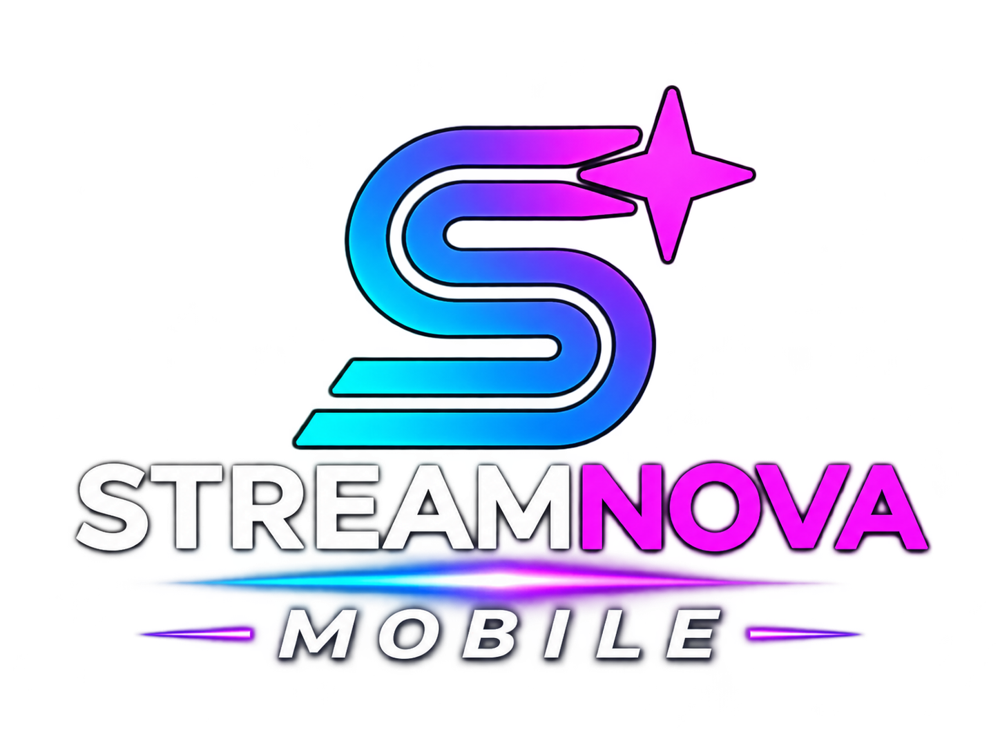

  
  
<strong>Streaming, ovunque. La tua esperienza StreamNova su smartphone e tablet.</strong>

# StreamNova Mobile

**StreamNova Mobile** è la versione Android di StreamNova progettata per smartphone e tablet. Condivide il core tecnologico con StreamNova TV, ma viene distribuita come applicazione indipendente, con interfaccia touch e layout adattivi.

> Repository dedicata all'app Mobile. Il modulo Android TV non è incluso in questo repository.

## Caratteristiche principali

- **Cataloghi e discovery:** navigazione dei contenuti, sezioni Home, Film e Serie, ricerca e schede di dettaglio con metadati e artwork TMDB.
- **Continua a guardare:** ripresa dei contenuti e sincronizzazione SIMKL, quando configurata nella build.
- **Riproduzione video:** motore basato su Media3/ExoPlayer e componenti Nuvio, con sorgenti HTTP e flussi Debrid/TorBox.
- **Selezione delle sorgenti:** scelta manuale dei flussi disponibili e gestione delle varianti di qualità.
- **Qualità adattiva:** BandwidthMeter con stima iniziale di 50 Mbps per favorire la selezione iniziale della rendition HLS più alta disponibile, adattandosi poi alla banda effettiva.
- **TorBox:** risoluzione dei file con corrispondenza stagione/episodio, selezione della variante corretta e cache dei link distinta per file.
- **Sottotitoli e audio:** preferenze di lingua e personalizzazione dei sottotitoli e delle opzioni audio supportate dal player.
- **Controlli del player:** barra comandi con auto-hide, seek e anteprime, impostazioni di riproduzione, overlay di caricamento e pausa.
- **Parental Guide:** avvisi sui contenuti supportati, se abilitati nelle impostazioni.
- **Account e servizi:** integrazione SIMKL e supporto ai servizi/add-on previsti dalla configurazione dell'app.
- **Smartphone e tablet:** interfaccia touch adattiva; smartphone portrait fuori dalla riproduzione e player in landscape durante il playback; tablet in landscape.

Le sorgenti e i servizi esterni richiedono account, configurazioni o abbonamenti propri quando previsti. StreamNova non fornisce né ospita i contenuti multimediali.

## Identità Visiva

StreamNova Mobile mantiene l'identità grafica ufficiale StreamNova:

- Logo e wordmark StreamNova con dicitura **Mobile**.
- Simbolo geometrico con gradiente neon ciano, blu, viola e magenta.
- Contrasto tra lettering chiaro e accenti luminosi.
- Palette, componenti e linguaggio visivo condivisi con StreamNova TV.
- Layout e controlli adattati all'interazione touch, senza cambiare il marchio.

## Configurazione della chiave API TMDB

StreamNova utilizza **The Movie Database (TMDB)** per metadati, cataloghi e immagini dei contenuti.

1. Crea o accedi al tuo account su [themoviedb.org](https://www.themoviedb.org/).
2. Apri [Impostazioni API](https://www.themoviedb.org/settings/api) e richiedi una API Key v3.
3. Nella root del progetto, crea un file locale .env copiando .env.example, oppure aggiungi la chiave a local.properties.

Esempio .env:

\`\`\`properties
TMDB_API_KEY=INSERISCI_LA_TUA_CHIAVE
\`\`\`

Oppure in local.properties:

\`\`\`properties
TMDB_API_KEY=INSERISCI_LA_TUA_CHIAVE
\`\`\`

In alternativa, da PowerShell prima della build:

\`\`\`powershell
$env:TMDB_API_KEY = "INSERISCI_LA_TUA_CHIAVE"
\`\`\`

La build legge il valore da variabile d'ambiente, local.properties o .env. **Non inserire mai una chiave reale in file tracciati da Git o in commit pubblici.** La chiave incorporata nell'APK può essere estratta: questa procedura evita di pubblicarla nel repository, ma non la rende segreta una volta distribuita l'app.

Senza chiave TMDB l'app può essere compilata, ma cataloghi e ricerca remota basati su TMDB non saranno disponibili correttamente.

## Download & Installazione

### Download APK

Gli APK ufficiali saranno pubblicati nella sezione [Releases](https://github.com/miciotto-web/StreamNova-Mobile/releases).

1. Apri la pagina [Releases](https://github.com/miciotto-web/StreamNova-Mobile/releases).
2. Scarica l'APK Mobile adatto alla release.
3. Trasferisci il file sul dispositivo Android, se necessario.
4. Apri l'APK e autorizza l'installazione da quella sorgente quando Android lo richiede.
5. Completa l'installazione.

Per aggiornare un'installazione esistente mantenendo dati e impostazioni, l'APK deve essere firmato con la stessa chiave dell'app già installata. Non disinstallare l'app per aggirare un errore di firma: la disinstallazione può cancellare i dati locali.

### Compilazione da sorgente

Requisiti: Windows, JDK 17 e Android SDK configurato.

Da PowerShell nella cartella del repository:

\`\`\`powershell
.\gradlew.bat :mobile:assembleDebug
.\gradlew.bat :mobile:testDebugUnitTest
\`\`\`

APK debug generato:

\`\`\`text
mobile/build/outputs/apk/debug/mobile-debug.apk
\`\`\`

Per una build release firmata occorre configurare le credenziali di firma **localmente** tramite le variabili d'ambiente previste dal progetto. Non condividere keystore o password.

## Architettura

Il progetto utilizza Kotlin e Jetpack Compose. Le responsabilità condivise sono organizzate nei moduli:

| Modulo | Responsabilità |
|---|---|
| :mobile | Applicazione Android Mobile, schermate, navigazione e integrazione touch |
| :core:model | Modelli e tipi di dominio |
| :core:designsystem | Tema, palette, branding e componenti visivi condivisi |
| :core:data | Repository, persistenza e integrazioni dati |
| :core:player | Componenti e logica condivisa del player |

La versione Android TV è mantenuta separatamente e non fa parte del codice applicativo pubblicato qui.

## Stato del progetto

StreamNova Mobile è in sviluppo attivo. Le funzionalità possono variare tra release; per le modifiche e le correzioni consultare la cronologia Git e le note associate alle singole versioni.

## Crediti

- Metadati e immagini: [TMDB](https://www.themoviedb.org/).
- Riproduzione: AndroidX Media3/ExoPlayer e componenti Nuvio utilizzati dal progetto.
- Sincronizzazione: SIMKL, quando disponibile e configurato.

---

**StreamNova Mobile** — progetto indipendente sviluppato e mantenuto da miciotto-web.
